# Synthèse qualité, tests et CI — Penderie

> Séance 16, 14/10/2026. Choix et justification de la couverture : [coverage.md](coverage.md).
> Captures générées depuis les sorties réelles des commandes (`docs/captures/capture-terminal.mjs`), et par Cypress (`cy.capture`).

## Tout passe par le Makefile

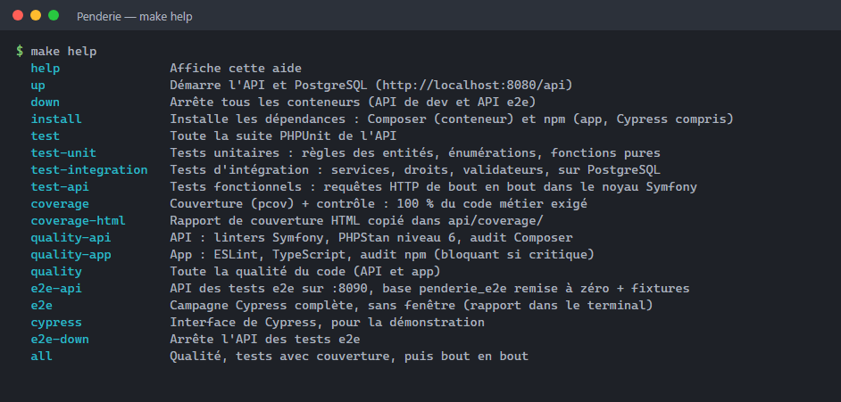

| Commande | Ce qu'elle lance |
|---|---|
| `make test` / `test-unit` / `test-integration` / `test-api` | PHPUnit, toute la suite ou un niveau |
| `make coverage` | PHPUnit + couverture (pcov), puis `bin/coverage-check` (100 % métier exigé) |
| `make quality` | linters Symfony, PHPStan niv. 6, audit Composer ; ESLint, TypeScript, audit npm |
| `make e2e` / `make cypress` | API e2e (:8090, base `penderie_e2e` + fixtures), puis Cypress sans fenêtre / interface |
| `make all` | qualité, couverture, bout en bout |

## Tests et couverture

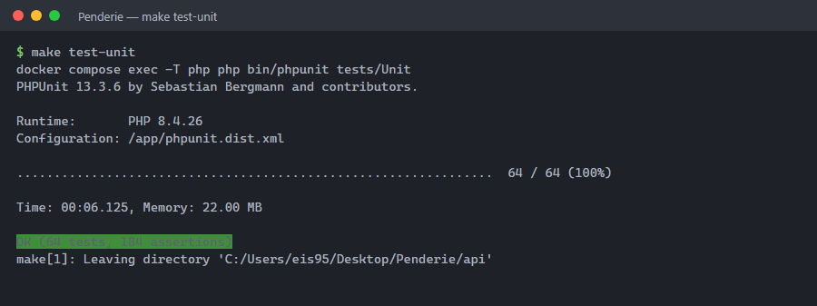

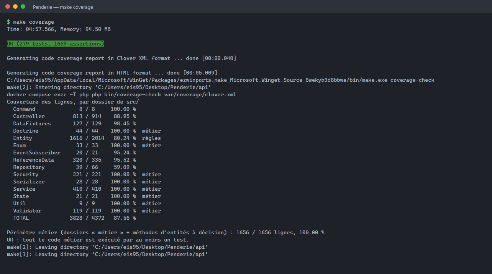

Rapport HTML (`make coverage-html`) :

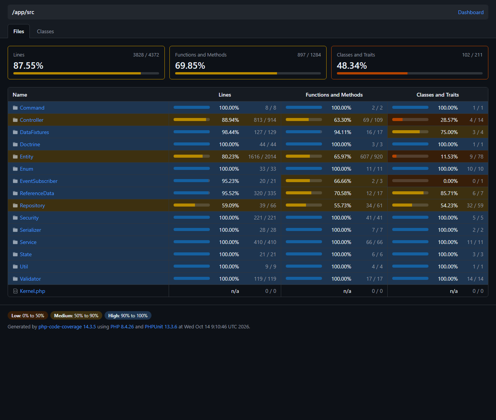
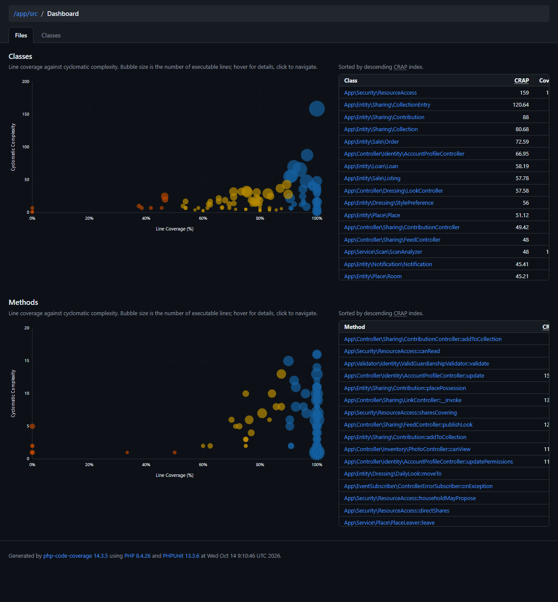

## Analyse statique et audits

Extrait filtré du journal (commandes et verdicts) : 0 erreur PHPStan, linters OK, aucune faille Composer. Côté npm, il reste 36 vulnérabilités modérées ou hautes dans l'outillage Expo, et aucune critique. Elles sont non bloquantes, suivies dans `audit.md`.

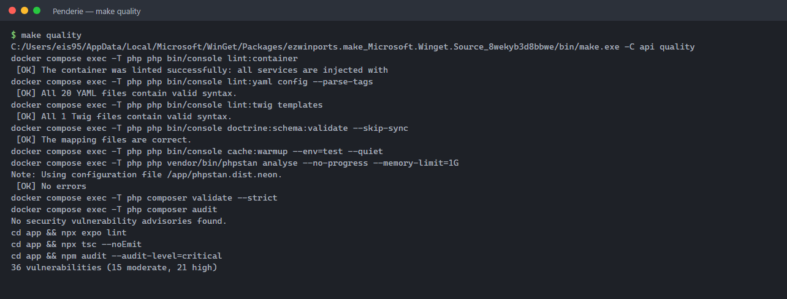

## Bout en bout (Cypress)

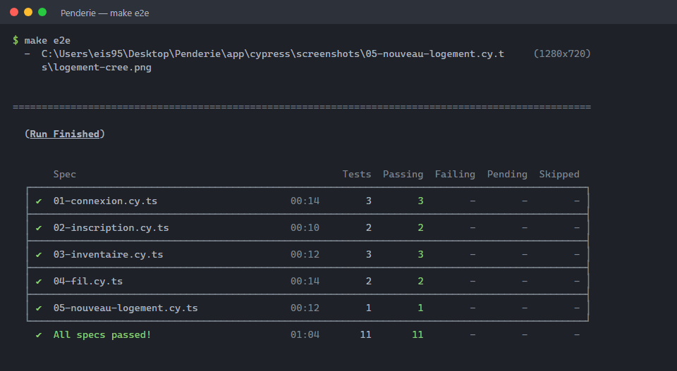

| | |
|---|---|
| 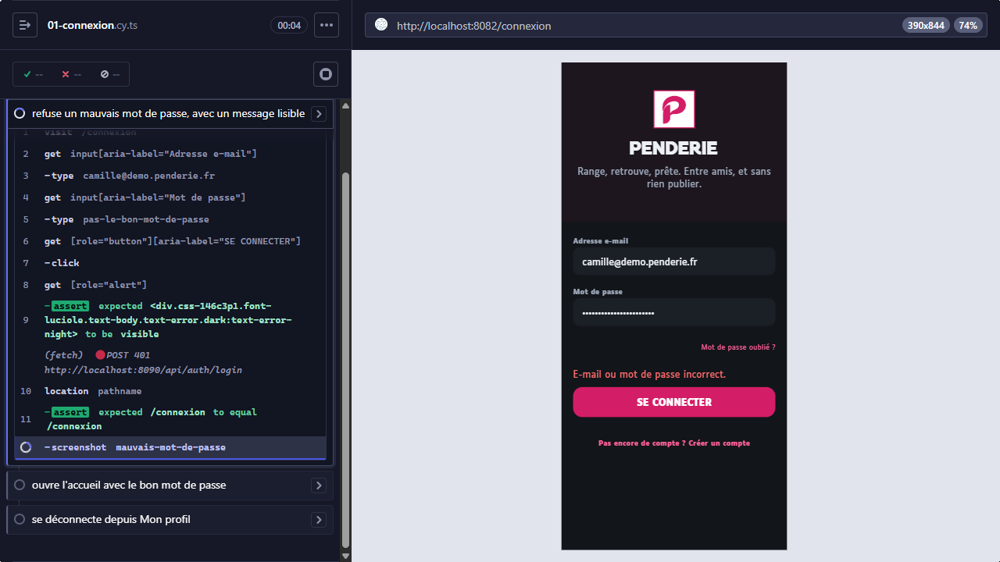 | 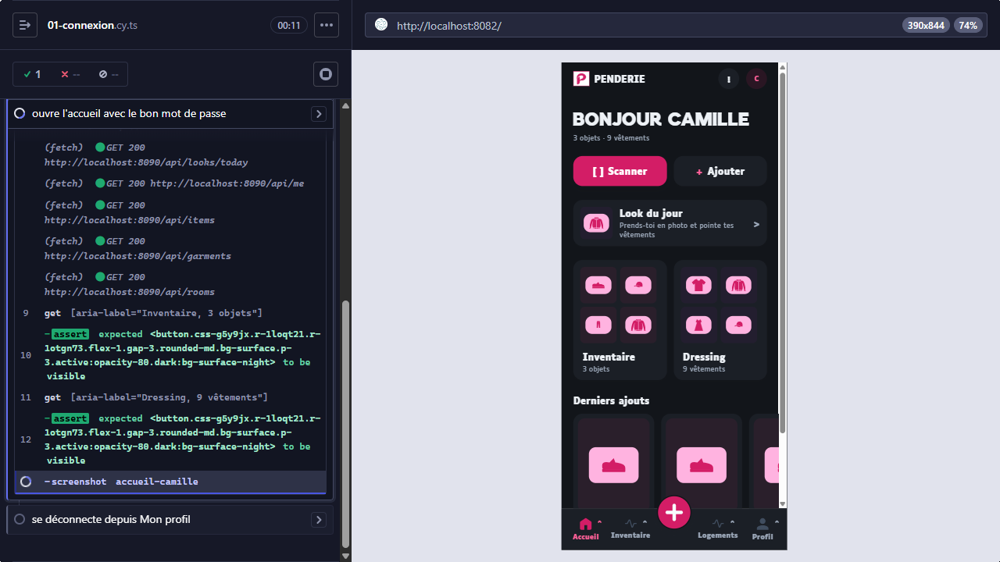 |
| 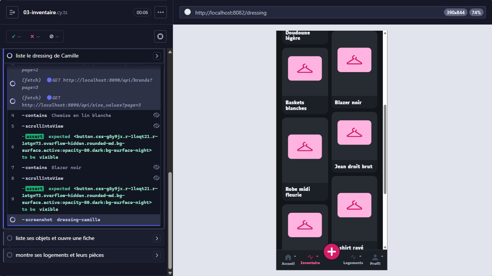 | 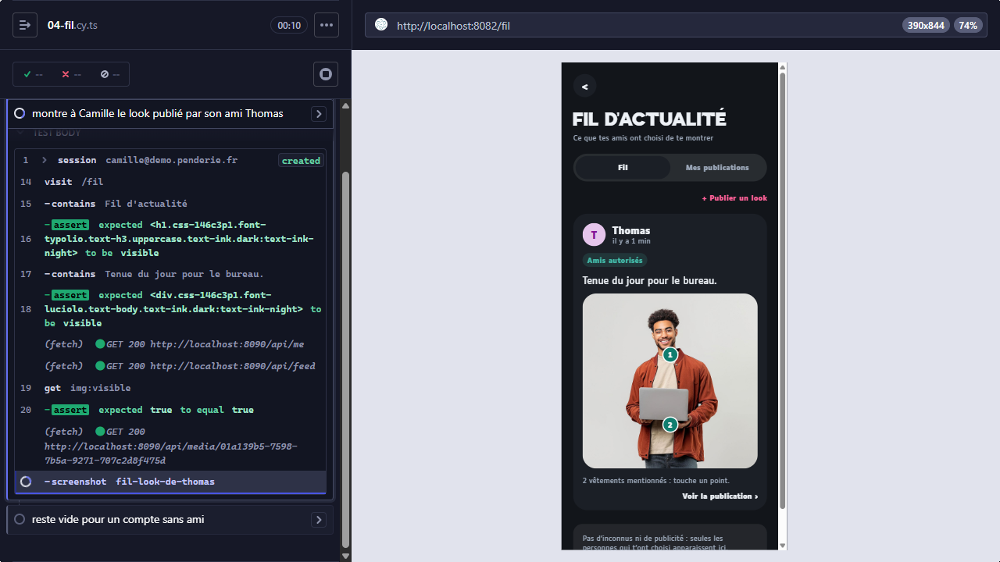 |
| 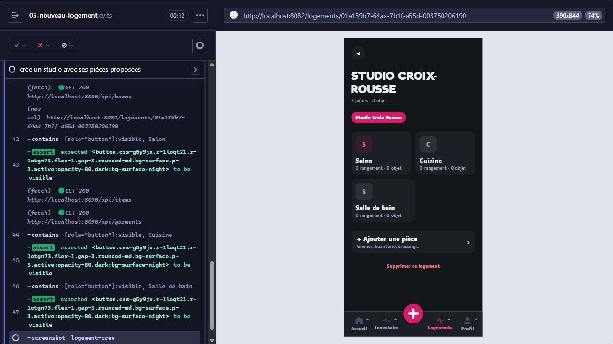 | |

**Démonstration** : `make cypress` ouvre l'interface. On choisit une spec, et on voit chaque commande s'exécuter sur l'app.

## Intégration continue (GitHub Actions)

| Workflow | Jobs | Bloquant |
|---|---|---|
| `api.yml` | migrations (aller-retour), schéma, **PHPUnit avec couverture + contrôle 100 % métier** (ajouté en séance 16) ; qualité (PHPStan, linters, audit) ; Snyk | oui |
| `app.yml` | ESLint, TypeScript, audit npm (critique) | oui |

**À intégrer avec Thomas : le job e2e.** Proposition : un service PostgreSQL, puis PHP 8.4 lancé directement (`symfony server` ou `php -S`) avec `APP_ENV=dev`, `APP_DEBUG=0` et `DATABASE_URL=…/penderie_e2e`. Ensuite, les commandes de `make e2e-db` sans Docker (`make -C api e2e-db E2E=` est à adapter), puis `cd app && npm ci && npm run e2e` (Node 22, Cypress embarque Electron). Les captures en cas d'échec sont dans `app/cypress/screenshots`, à publier en *artifact*.
